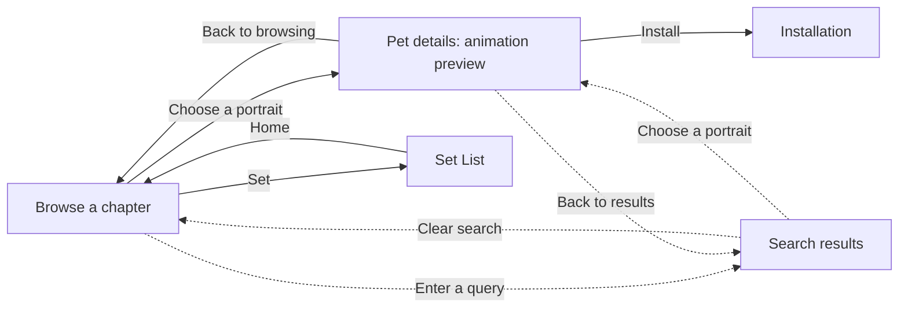

# Pet gallery design

Visitors come here to find a pet, see how it moves and install it. The gallery borrows the open book from Global MapleStory v102: left-edge buttons for Home, Set and Back; bookmarks on the right edge for chapters; monster portraits on the right page. Use the [original book artwork](../../assets/maplestory/ui/monster-book/) at its native proportions. Keep the search field above the portrait grid, as in the [v102 Home screenshot](https://mapleglobalnews.wordpress.com/2011/10/28/gms-v-102-rise-of-fellowship/).

## Screen flow

This is the intended gallery, including screens that have not shipped. Dashed arrows describe the search proposal under review.

## Browsing decisions

- **Chapters.** Show all nine bookmarks from the start. Exactly one extends while browsing. Each page belongs to one chapter; if only three pets remain on its last page, show those three and leave the other slots blank. A visitor can go directly to any chapter, even an empty one.
- **Page turns.** Next and Previous turn pages within a chapter. At a boundary, Next opens the first page of the next chapter; Previous opens the last page of the preceding one. The bookmark follows the page. The [original book](references/gms-v102.md#how-did-the-bookmarks-and-arrows-work) could mix chapters on one spread; keeping a single chapter per page gives the extended bookmark one meaning.
- **Sections.** Home returns to chapter 1, page 1. Set opens without a collection requirement and hides the chapter bookmarks. Its contents are undecided. Back stays disabled until there is a selected item to leave.
- **Pet details.** A portrait will open a detail spread with the pet’s animation preview on the left and a way to install it. A pet is available because it was published; there is no level gate, discovery requirement, or Familiar naming or summoning flow.

## Search: proposed behavior for review

Search filters pets by the text entered. The matching algorithm can be decided separately. The open design question is how bookmarks and page turns should behave while the query is active.

**Recommendation: search all chapters first.** Keep all nine bookmarks visible but retracted, mark the scope as **All chapters**, and fill the portrait grid with matches in catalog order. One match in each of four chapters produces four adjacent portraits on one page. Keeping each chapter on its own search page, even if Next skips empty chapters, would still require three page turns to see the same four pets.

| Action in search | Proposed result |
| --- | --- |
| Select a chapter bookmark | Keep the query and show only matches from that chapter. Only that bookmark extends. An **All chapters** control restores the full results without retyping. |
| Change the query or scope | Start on results page 1. Next and Previous page through the matches in the displayed scope. If nothing matches, show the query and scope with a way to broaden or clear the search. |
| Open a pet, then go Back | Return to the same results page with the same query and scope, with focus back on the portrait. |
| Clear search | Return to the chapter and page the visitor was browsing before typing. |

This follows the [GOV.UK pagination guidance](https://design-system.service.gov.uk/components/pagination/#filtering-and-sorting) to filter a whole list before dividing it into pages. It leaves the game’s ambiguous bookmark state on detail screens out of the gallery’s search design.

## Game references

[GMS v102: cards, bookmarks and sets](references/gms-v102.md) records the original level bands, how ordinary cards can belong to several sets, and what the recordings actually show. Later versions are identified separately wherever their screenshots or recordings supply evidence. How pets will be assigned to chapters and whether the gallery will use Sets as collections remain open.
